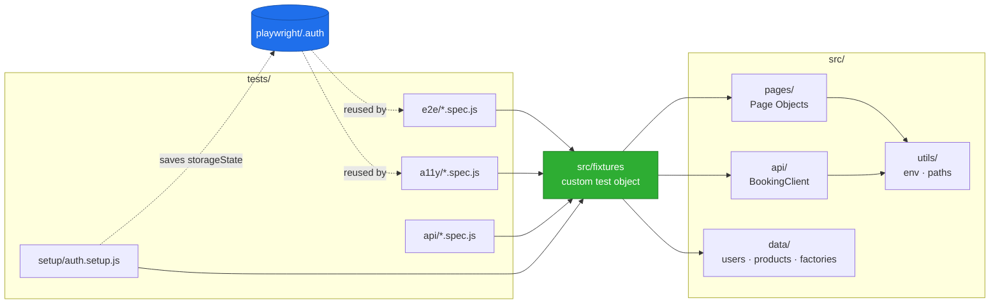
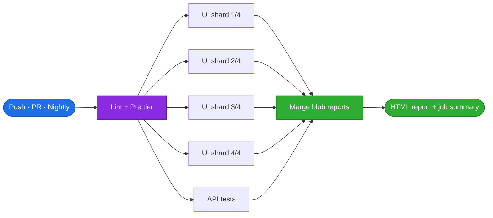

<div align="center">


<p>
  <a href="https://github.com/DilSenevirathna/playwright-automation-framework/actions/workflows/playwright.yml"></a>
  
  
  
  
</p>

<p>
  
  
  
  
  
</p>

**A test automation framework I built to show how I approach quality engineering on a real team: fast feedback, readable tests, and a pipeline you can trust.**

[Why this exists](#-why-this-exists) •
[Architecture](#-architecture) •
[Quick start](#-quick-start) •
[Design decisions](#-design-decisions) •
[CI/CD](#-cicd-pipeline) •
[About me](#-about-the-author)

</div>

---

## 🎯 Why this exists

Most demo repos stop at "click a button, assert a title". Real suites go wrong in other ways: flaky waits, tests that depend on each other, ten-minute pipelines, and reports nobody opens.

This project is my answer to those problems. It tests two public demo systems end to end:

| Target | What it is | What I test |
| --- | --- | --- |
| 🛒 [SauceDemo](https://www.saucedemo.com) | E-commerce web app | Login, catalogue, cart, checkout, accessibility |
| 🏨 [Restful-Booker](https://restful-booker.herokuapp.com/apidoc/index.html) | Booking REST API | Full CRUD, auth, negative cases, data cleanup |

Both are public and free to hit, so anyone can clone this and see it run in a couple of minutes.

---

## ✨ Highlights

| | Feature | What it means in practice |
| --- | --- | --- |
| 🧱 | **Page Object Model** | Specs read like user stories; selectors live in exactly one place |
| 🔌 | **Custom fixtures** | Page objects, API client and guard rails are injected, so specs contain no setup code |
| 🔐 | **Cached authentication** | Log in once via a setup project and reuse `storageState` everywhere (large runtime saving) |
| 🌐 | **Cross-browser + mobile** | Chromium, Firefox, WebKit and a Pixel 7 viewport for smoke tests |
| 🧪 | **UI + API in one runner** | The `api` project launches no browser at all |
| ♿ | **Accessibility gate** | axe-core scans with a documented baseline, so new critical issues fail the build |
| 🧹 | **Self-cleaning API tests** | A `bookings` fixture deletes everything it creates, even when the test fails |
| 🎲 | **Faker-based test data** | Fresh data each run, seedable when you need to reproduce a failure |
| 🏷️ | **Tag-based selection** | `@smoke`, `@regression`, `@api`, `@a11y`, `@security` |
| 🚦 | **Sharded GitHub Actions** | 4 parallel shards, merged into a single HTML report |
| 📊 | **Custom reporter** | Run summary with a per-project table and the slowest tests, written to the job summary |
| 🐳 | **Dockerfile** | Same browsers and versions on every machine |

> **Test volume:** 22 UI scenarios × 3 browsers, 5 mobile smoke tests, 4 accessibility checks, 8 API tests and 1 auth setup step, which comes to **84 executions** per run.

---

## 🏗 Architecture



### 📁 Project structure

```text
playwright-automation-framework/
├── .github/workflows/
│   └── playwright.yml          # lint → sharded UI + API → merged report
├── src/
│   ├── api/
│   │   └── BookingClient.js    # REST client: auth, CRUD, headers in one place
│   ├── data/
│   │   ├── a11yBaseline.js     # known, documented accessibility exceptions
│   │   ├── factories.js        # faker builders for checkout + booking payloads
│   │   ├── products.js
│   │   └── users.js
│   ├── fixtures/
│   │   └── index.js            # the project's `test` object
│   ├── pages/                  # BasePage, LoginPage, InventoryPage, CartPage, CheckoutPage
│   ├── reporters/
│   │   └── summary-reporter.js # custom reporter (terminal + GitHub job summary)
│   └── utils/                  # env loading, shared paths
├── tests/
│   ├── setup/                  # one-time login, saves the session
│   ├── e2e/                    # login, session, catalogue, cart, checkout
│   ├── api/                    # booking CRUD + auth/negative cases
│   └── a11y/                   # axe scans + keyboard navigation
├── playwright.config.js        # projects, reporters, retries, timeouts
├── Dockerfile
└── eslint.config.js · .prettierrc · .env.example
```

---

## 🧠 Design decisions

These are the choices I would defend in a code review.

<details>
<summary><b>1. Authenticate once, not in every test</b></summary>

<br />

Logging in through the UI before every test is the single biggest source of wasted time in most suites. A dedicated `setup` project logs in once and writes the session to `playwright/.auth/`. Browser projects depend on it and start already signed in.

Tests that are *about* login override this with an empty `storageState`, so they still start from a clean slate.

```js
// playwright.config.js
{
  name: 'chromium',
  use: { ...devices['Desktop Chrome'], storageState: AUTH_FILE },
  dependencies: ['setup'],
}
```

</details>

<details>
<summary><b>2. Fixtures instead of <code>beforeEach</code> boilerplate</b></summary>

<br />

Specs import `test` from `src/fixtures`, not from `@playwright/test`. That one import gives them page objects, an API client and a few safety nets. The built-in `page` fixture is extended so a test also fails if the app throws an uncaught browser exception, even when all visible assertions passed.

```js
page: async ({ page }, use) => {
  const errors = [];
  page.on('pageerror', (error) => errors.push(error.message));
  await use(page);
  expect.soft(errors, 'uncaught exceptions in the browser').toEqual([]);
},
```

</details>

<details>
<summary><b>3. API tests that clean up after themselves</b></summary>

<br />

Restful-Booker is a shared public service, so leaving data behind is bad manners and also makes tests order-dependent. The `bookings` fixture records every booking it creates and deletes them in teardown, whether the test passed or failed.

```js
test('reads back what was created', async ({ bookings, bookingApi }) => {
  const { id, payload } = await bookings.create();
  const response = await bookingApi.get(id);
  expect(await response.json()).toMatchObject(payload);
});
```

</details>

<details>
<summary><b>4. Page objects describe intent, specs hold the assertions</b></summary>

<br />

Page objects expose actions (`addToCart`, `fillShipping`) and locators. They do not assert. When a test fails, the failing line is in the spec and tells you which behaviour broke, rather than pointing deep into a helper.

Locators prefer `getByTestId` (mapped to the app's `data-test` attribute in the config) and `getByRole`, so styling changes do not break tests.

</details>

<details>
<summary><b>5. An accessibility baseline instead of "ignore everything"</b></summary>

<br />

axe-core is run on key pages, the complete findings are attached to the report as JSON, and the build fails on **new** critical violations. Issues that already exist in the third-party demo app are listed with a reason in `src/data/a11yBaseline.js`, so they stay visible and are trivial to remove once fixed.

</details>

<details>
<summary><b>6. No fixed sleeps, ever</b></summary>

<br />

Every wait is an assertion on something observable: a URL, a visible element, a count. The slow-user login test exists specifically to prove that the suite copes with a laggy backend by waiting on the right signal with a larger timeout instead of `waitForTimeout`.

</details>

<details>
<summary><b>7. Documenting API quirks in tests</b></summary>

<br />

Restful-Booker returns `201` for a successful `DELETE` and `200` with `{ "reason": "Bad credentials" }` for a failed login. The tests assert exactly that and say why, so the next engineer does not "fix" the assertion to a status code the service will never send.

</details>

---

## 🚀 Quick start

**Prerequisites:** Node.js 20 or newer and Git.

```bash
# 1. Clone
git clone https://github.com/DilSenevirathna/playwright-automation-framework.git
cd playwright-automation-framework

# 2. Install dependencies and browsers
npm install
npx playwright install --with-deps

# 3. (Optional) create a local env file. Defaults work without it.
cp .env.example .env

# 4. Run everything
npm test

# 5. Open the HTML report
npm run report
```

### Handy commands

| Command | What it does |
| --- | --- |
| `npm test` | Full suite across all projects |
| `npm run test:smoke` | Fast critical-path check (`@smoke`) |
| `npm run test:regression` | Deeper functional coverage (`@regression`) |
| `npm run test:api` | API tests only, no browser launched |
| `npm run test:a11y` | Accessibility scans and keyboard checks |
| `npm run test:mobile` | Smoke tests on a Pixel 7 viewport |
| `npm run test:headed` | Watch Chromium run the tests |
| `npm run test:ui` | Playwright's interactive UI mode |
| `npm run test:debug` | Step through with the Inspector |
| `npm run codegen` | Record a new test against SauceDemo |
| `npm run lint` · `npm run format` | Code quality |

### 🐳 Run in Docker

```bash
docker build -t pw-framework .
docker run --rm -v "$PWD/playwright-report:/app/playwright-report" pw-framework
```

---

## 🏷 Test tagging

Tags let the pipeline choose the right amount of testing for the situation.

| Tag | Purpose | Typical use |
| --- | --- | --- |
| `@smoke` | Critical user journeys | Every commit, mobile project |
| `@regression` | Broader functional coverage | Pull requests, nightly |
| `@api` | REST service checks | Backend-focused runs |
| `@security` | Auth and access control | Targeted security regression |
| `@a11y` | Accessibility | Pre-release |

```bash
npx playwright test --grep "@smoke"
npx playwright test --grep "@api" --grep-invert "@security"
```

---

## 🔄 CI/CD pipeline



- **Fail fast on quality:** lint and format checks run before any browser starts.
- **Sharded in parallel:** the UI suite is split into four jobs, and the API job runs alongside them without installing browsers.
- **One report:** each job uploads a blob report, and a final job merges them into a single HTML report plus a Markdown summary on the run page.
- **Evidence on failure:** traces on first retry, screenshots and video kept only for failed tests.
- **Nightly schedule:** catches changes in the systems under test even when the repo is quiet.

---

## 📊 Reporting

| Output | Where to find it |
| --- | --- |
| Interactive HTML report | `npm run report`, or the `playwright-report` artifact on a CI run |
| Run summary (per project, slowest tests) | Terminal output and the GitHub Actions job summary |
| Traces | Attached to retried failures, open with `npx playwright show-trace` |
| Accessibility findings | `axe-*.json` attachments inside each a11y test in the report |

---

## 🧰 Tech stack

<p>
  
  
  
  
  
  
  
</p>

`@playwright/test` · `@axe-core/playwright` · `@faker-js/faker` · `dotenv` · `eslint-plugin-playwright`

---

## 🗺 Roadmap

- [ ] Visual regression tests with committed baselines
- [ ] Publish the merged HTML report to GitHub Pages
- [ ] Contract testing for the booking API with JSON-schema validation
- [ ] Trend tracking for flaky tests across nightly runs

---

## 👩‍💻 About the author

<div align="center">

### **Dilmi Senevirathna**
*QA Automation Engineer*

I care about tests that people trust: stable, quick to run and easy to read. This repository is how I like to structure automation when I get to set the standard.

<a href="https://www.linkedin.com/in/dilmi-senevirathna-6b6933228"></a>
<a href="https://github.com/DilSenevirathna"></a>

*If this repo was useful or you'd like to talk about test automation, I'd love to hear from you. A ⭐ is always appreciated.*

</div>

---

<div align="center">

Released under the [MIT License](LICENSE) · © 2026 Dilmi Senevirathna


</div>
